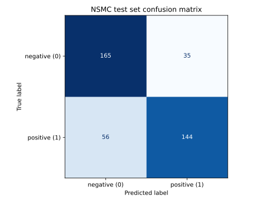

# NSMC 리뷰 검색·감성 분류: TF-IDF를 직접 구현하며 배우기

네이버 영화 리뷰(NSMC)를 `원문 → 정제 → 형태소 토큰 → TF-IDF 벡터 → 검색/분류` 순서로 처리한다. 핵심 목표는 라이브러리를 호출하는 데서 끝내지 않고, 각 단계가 무엇을 학습하고 계산하는지 설명하는 것이다. NSMC의 `label=0`은 부정, `label=1`은 긍정이다. 실습 과정과 판단 근거는 [REPORT.md](docs/REPORT.md)에 자세히 기록했다.

## 1. 구현 요약

### 기능 요구사항과 코드 연결

| 요구사항 | 구현 모듈 | 실제 처리 | 학습할 개념 |
| --- | --- | --- | --- |
| 데이터 확인 | [`explore_nsmc.py`](explore_nsmc.py) | NSMC TSV의 열·레이블 분포·빈 리뷰·중복을 집계하고 원본 파일을 받는다. | 레이블, 중복, 데이터 품질 |
| 정제·토큰화·불용어 | [`preprocess_nsmc.py`](preprocess_nsmc.py) | 영문 소문자화, 문자 범위 정제, Okt 형태소 분석, 품사를 확인한 조사 제거를 수행한다. | 토큰화, 형태소, 불용어 |
| NumPy TF-IDF | [`numpy_tfidf.py`](numpy_tfidf.py) | `fit`에서 어휘·IDF를 계산하고 `transform`에서 TF-IDF와 L2 정규화 벡터를 만든다. | BoW, TF, 문서 빈도, IDF, 벡터 정규화 |
| scikit-learn과 수치 검증 | [`tfidf_nsmc.py`](tfidf_nsmc.py) | 같은 1,000개 리뷰·어휘·설정에서 행렬과 IDF의 오차를 비교한다. | 수치 검증, 비교 조건 통제 |
| 코사인 유사도 검색 | [`main.py`](main.py) | 쿼리를 기존 어휘로 변환하고 NumPy 내적·벡터 길이로 점수를 계산해 상위 5개를 반환한다. | 벡터 공간, 코사인 유사도, top-k 검색 |
| 감성 분류 및 평가 | [`classify_nsmc.py`](classify_nsmc.py) | TF-IDF를 특성으로 Logistic Regression을 학습하고 정확도·macro F1·혼동 행렬·오분류를 기록한다. | 데이터 분리, 분류 기본선, 성능 평가 |

코드를 따라 읽을 때는 `preprocess_text(text, tagger) → (정제문, 토큰, 제거한 조사 수)`, `NumpyTfidfVectorizer.fit(문서별 토큰) → 학습된 벡터화기`, `transform(문서별 토큰) → NumPy 행렬`, `ReviewSearch.search(query, topk=5) → (쿼리 토큰, [(점수, 문서 ID, 스니펫), …])` 순서로 보면 된다.

원본 `ratings_train.txt`는 150,000개 리뷰이며 `data/`에 보관하고 Git에는 넣지 않는다. 검색은 원문 중복을 정리한 **2,000개 리뷰**를 대상으로 한다. 분류는 같은 원문에 서로 다른 레이블이 붙은 그룹을 제외하고 부정·긍정 각 1,000개를 별도로 추출한다. 분류용 표본을 레이블 비율을 유지하며 8:2로 나누고, **Train 1,600개에서만 어휘와 IDF를 `fit`**한다. Test 400개에는 `transform`만 적용한다. 검색과 분류의 2,000개 표본은 동일한 집합이 아니다.

전처리는 한글 음절·자모, 영문, 숫자, 공백을 남긴다. `Okt.pos(norm=True, stem=True)`로 형태소와 품사를 얻고, 선택한 12개 조사가 `Josa`일 때만 제거한다. 부정어와 영화 관련 단어는 유지한다. 자세한 기준은 아래 인터뷰 5번과 [실습 기록](docs/REPORT.md#3-전처리-파이프라인-실습)에 있다.

### TF-IDF 구현 과정

문서 `d`, 토큰 `t`, 학습 문서 수 `N`, 토큰 `t`가 나타난 문서 수 `df(t)`에 대해 이 프로젝트의 정의는 다음과 같다.

```text
TF(t, d)       = 문서 d에서 t의 출현 횟수
IDF(t)         = log((1 + N) / (1 + df(t))) + 1
TF-IDF(t, d)   = TF(t, d) × IDF(t)
최종 문서 벡터 = TF-IDF 벡터 / 해당 벡터의 L2 길이
```

`fit`은 학습 문서에서 어휘 목록과 `df`, `IDF`를 정한다. `transform`은 **이미 정해진 어휘·IDF**로 입력 문서의 TF를 세고, 곱한 뒤 L2 정규화한다. Test 문서나 검색 쿼리에 새 단어가 있어도 어휘·IDF를 다시 학습하지 않는다. 계산 행렬은 모든 0까지 저장하는 NumPy **조밀한 행렬**이므로 실습 표본 크기를 제한했다.

작은 계산 예시를 보자. `d₁ = 영화 영화 재미`, `d₂ = 영화 지루`라면 열을 `[영화, 재미, 지루]`로 고정할 수 있다. `df=[2,1,1]`이고 `IDF=[1, 1+log(3/2), 1+log(3/2)]≈[1,1.405,1.405]`다.

| 단계 | d₁ | d₂ |
| --- | --- | --- |
| TF | `[2, 1, 0]` | `[1, 0, 1]` |
| TF × IDF | `[2, 1.405, 0]` | `[1, 0, 1.405]` |
| L2 정규화 후 | `[0.818, 0.575, 0]` | `[0.580, 0, 0.815]` |

로그는 큰 역빈도 비율을 **압축**한다. 분모의 `+1`은 수식상 `df=0`도 0으로 나누지 않게 하지만, 실제 `fit`은 등장한 토큰만 어휘에 넣으므로 학습 어휘의 `df`는 최소 1이다. 미등록 토큰은 `transform`에서 무시한다.

## 2. 검증·실험 결과

### 직접 구현과 scikit-learn 비교

부정 500개·긍정 500개, 총 1,000개 리뷰의 **같은 Okt 토큰**을 양쪽 구현에 넣었다. scikit-learn `TfidfVectorizer` 설정은 `analyzer=str.split`, `vocabulary=직접 구현 어휘`, `lowercase=False`, `use_idf=True`, `smooth_idf=True`, `sublinear_tf=False`, `norm='l2'`, `dtype=float64`다. 따라서 기본 토큰 패턴이나 열 순서의 차이가 오차에 섞이지 않는다.

| 검증 항목 | 결과 |
| --- | ---: |
| TF-IDF 행렬 | 1,000 × 3,346 |
| IDF 최대 오차 | 0 |
| 행렬 최대 오차 | 1.110223024625e-16 |
| 허용 오차 | 1e-6 |
| 판정 | PASS |

전체 설정과 실행 로그: [tfidf_validation.log](docs/tfidf_validation.log). 이는 **수식 구현의 일치**를 확인한 것이며 검색 품질이나 분류 정확도를 보장하지 않는다.

### 검색과 분류

검색 쿼리 `배우들의 연기가 훌륭하다`는 `배우, 들, 연기, 훌륭하다`로 토큰화됐다. 2,000개 리뷰 중 코사인 점수가 높은 순서로 다음 결과를 얻었다. 점수는 쿼리와 문서의 방향이 얼마나 가까운지 나타내며, 감성 긍정 확률은 아니다.

| 순위 | 점수 | 문서 ID | 원문 스니펫 |
| ---: | ---: | --- | --- |
| 1 | 0.361903 | 6758524 | 배우들은 매력적이었다 |
| 2 | 0.349816 | 5711325 | 배우가 아깝다. |
| 3 | 0.340131 | 9640025 | 탄탄한 스토리 ,훌륭한 배우연기,눈이 호강할 액션그리고 놀랄 반전이 있는 모든 장점을 모아두는것 같은 영화다 |
| 4 | 0.311136 | 140534 | 좋지도 않고 나쁘지도않다. 하지만 배우들의 연기에 감동해서 점수를 준다. |
| 5 | 0.298883 | 9706100 | 솔직히 재미있다. 스토리도 괜춘하고.. 배우들의 연기도 참 좋은거 같은데;; |

분류 기본선은 `LogisticRegression(max_iter=1000, random_state=42)`이다. 400개 Test 리뷰에서 **정확도 0.772500**, **macro precision 0.775538**, **macro recall 0.772500**, **macro F1 0.771871**을 얻었다. 혼동 행렬은 행이 실제 레이블, 열이 예측 레이블이다.

| 실제 \ 예측 | 부정 (0) | 긍정 (1) |
| --- | ---: | ---: |
| 부정 (0) | 165 | 35 |
| 긍정 (1) | 56 | 144 |



분류 실행 로그: [classification_validation.log](docs/classification_validation.log). 오분류 91개 중 5개는 [실습 기록의 사례 분석](docs/REPORT.md#오분류-사례-5개)에서 원문·토큰·모델 가중치를 함께 확인했다.

오류와 관련된 **관찰 신호**를 평가 데이터 전체에서 세면 다음과 같다. 여러 신호가 한 리뷰에 함께 나타날 수 있고, 이 표만으로 오류의 원인이나 개선 효과가 입증되는 것은 아니다.

| 관찰 신호 | 오분류 91개 중 | 정분류 309개 중 |
| --- | ---: | ---: |
| 학습 어휘 밖 토큰 포함 | 68 (74.7%) | 191 (61.8%) |
| 토큰 3개 이하 | 15 (16.5%) | 32 (10.4%) |
| 부정 표현 토큰 포함 | 21 (23.1%) | 58 (18.8%) |

## 3. 한계와 개선 방향

BoW 기반 TF-IDF는 단어의 **등장 여부와 빈도**를 표현하지만, 단어 순서나 부정의 적용 범위를 직접 저장하지 않는다. 실제 오분류에서 `볼만함`은 `볼, 만, 함`으로 분리되어 `만`이 부정 방향으로 작용했고, `잘 만든 액션 영화는 아니라고`에서는 `아니다`의 부정 기여보다 다른 단어들의 긍정 기여가 커서 긍정으로 예측됐다. `개쩌`처럼 학습 어휘에 없는 표현은 벡터에서 빠졌다. `그것이 알고싶다짱`처럼 짧은 문장에서는 레이블의 이유도 원문만으로 확정하기 어렵다.

**다의어도 같은 차원에 합쳐진다.** 원본 NSMC의 `사과가 썩는 것은 사과 잘못이 아니다`(과일, id `9190813`)와 `사과 한 마디 받기 참 힘든 세상!`(사죄, id `10276456`의 첫 부분)은 Okt 결과에 모두 `사과`가 들어간다. TF-IDF는 두 의미를 구별하는 별도 값을 만들지 않는다. `사과`가 포함된 문장을 모아 주변 단어를 확인하고 의미를 수작업으로 표기하면 혼합 정도를 조사할 수 있다. 문맥 임베딩이나 단어 의미 중의성 해소(WSD)는 그 후 비교할 대응법이며 이번에는 구현하지 않았다.

**다른 데이터셋에 그대로 적용되지는 않는다.** 현재 입력기는 `id/document/label` 열을 가진 한국어 NSMC TSV를 가정한다. 한국어 다른 도메인에서는 도메인 단어·불용어와 구두점의 의미를 재검토해야 하고, 영어라면 Okt 대신 영어 토큰화·표제어 처리와 그 언어의 불용어 기준이 필요하다. 레이블 없는 자료에는 검색을 적용할 수 있지만 분류 학습·평가에는 정답 레이블이 필요하다. 새 코퍼스의 어휘·문서 빈도가 달라지므로 TF-IDF를 해당 **학습 문서에서 다시 `fit`**해야 한다. 벡터화 클래스는 토큰 목록을 입력받아 재사용할 수 있으나, 파일 로더와 전처리는 교체해야 한다.

**규모도 현재 구현의 제약이다.** 검색의 `2,000 × 5,118`개 `float64` 값은 조밀한 행렬 한 개만 약 **81.9 MB**를 차지하고, 계산 중 임시 배열까지 고려하면 더 필요하다. 100만 문서와 5만 어휘라면 한 행렬만 **약 400 GB**다. 그 규모를 목표로 할 때는 0이 아닌 값만 담는 희소 행렬을 쓰고, 검색에는 `토큰 → 포함 문서와 가중치`의 역색인을 만들어 쿼리 토큰의 문서만 점수화할 수 있다. 새 문서는 별도 증분 색인에 넣고 주기적으로 본 색인과 병합하되, 문서 수·문서 빈도 변화로 **IDF도 갱신**해야 한다. 단일 장비로 부족하면 문서별 샤드에서 얻은 상위 결과를 합칠 수 있다. 이는 설계안이며 실제 속도·메모리 효과를 측정한 결과는 아니다.

다음 비교 실험에서는 **동일한 분할과 전처리**를 고정하고 1-gram 대비 1+2-gram의 macro F1 변화, 형태소 오류 수정 전후의 오류 수를 측정한다. 검색은 별도의 질의와 사람이 판정한 관련 문서 집합을 마련해 `Precision@5`를 비교해야 한다. 이번 NSMC 감성 레이블만으로 검색 관련도를 계산할 수는 없다. 이들은 **개선 후보와 측정 계획**이며 이번 결과에서 성능 향상이 입증된 것은 아니다.

## 실행 방법

Python 3.10 이상과 KoNLPy Okt 실행에 필요한 Java 환경이 필요하다. 아래 명령은 저장소의 `Q4_1` 디렉터리에서 실행한다. `explore_nsmc.py --download`는 [NSMC 원본 저장소](https://github.com/e9t/nsmc)의 학습 파일을 `data/ratings_train.txt`로 받는다.

```bash
cd Q4_1
python3 -m venv .venv
source .venv/bin/activate
pip install -r requirements.txt
python explore_nsmc.py --download
python main.py --query '배우들의 연기가 훌륭하다' --topk 5
python classify_nsmc.py
python tfidf_nsmc.py
```

검색 명령의 출력에는 `검색 문서: 2,000개 / 어휘: 5,118개`와 `1. [0.361903] id=6758524 배우들은 매력적이었다` 같은 상위 결과가 포함된다. `classify_nsmc.py`는 혼동 행렬 그림과 로그를 `docs/`에 저장한다. `tfidf_nsmc.py`는 전체 원본을 먼저 형태소 분석하므로 검색·분류보다 오래 걸린다.

## 인터뷰 질문

### 1. 토큰화의 목적은 무엇이고, 한국어와 영어는 어떻게 다르게 처리하는가?

**답:** 토큰화는 문장을 계산 가능한 단위로 나누어 어휘를 만들고 빈도를 셀 수 있게 한다. 영어는 단어 사이 공백이 비교적 분명해 공백·구두점 기반 분리가 출발점이 될 수 있지만, `don't` 같은 축약이나 `liked/like` 같은 형태 변화는 추가 처리가 필요하다. 한국어는 `영화는`처럼 어휘와 조사가 붙으므로 공백만 나누면 `영화`와 `영화는`이 다른 단어가 된다. 여기서는 Okt로 `영화/Noun`, `는/Josa`처럼 분석하고, 동사·형용사 어근화도 적용한다. 형태소 분석도 신조어·오타·띄어쓰기 오류를 항상 정확히 처리하지는 못한다.

### 2. TF, IDF, TF-IDF는 수학적으로 무엇이며 각각 무슨 역할인가?

**답:** `TF(t,d)=count(t,d)`는 문서 `d`에 단어 `t`가 몇 번 나타났는지 나타낸다. `df(t)`가 `t`를 포함한 학습 문서 수이고 `N`이 학습 문서 수일 때, 이 구현의 `IDF(t)=log((1+N)/(1+df(t)))+1`이다. 많은 문서에 공통으로 등장한 단어는 IDF가 낮고, 상대적으로 드문 단어는 높다. `TF-IDF(t,d)=TF(t,d)×IDF(t)`이므로 **해당 문서에 자주 나오면서 전체 문서에서는 드문 단어**가 큰 값을 얻는다. 마지막으로 문서 벡터를 L2 길이로 나눠 길이가 다른 리뷰도 방향 중심으로 비교한다. `+1` 평활화는 scikit-learn의 `smooth_idf=True`에 맞춘 선택이다.

### 3. 코사인 유사도는 내적과 정규화로 어떻게 계산하는가?

**답:** 쿼리 벡터 `q`와 문서 벡터 `d`에 대해 `cos(q,d)=(q·d)/(|q|₂|d|₂)`다. 내적 `q·d`는 두 벡터가 같은 단어 차원에서 큰 값을 가질수록 커진다. 각 벡터의 L2 길이로 나누면 크기 차이를 제거하고 **방향의 가까움**을 비교한다. 예를 들어 `q=(1,1)`, `d=(2,0)`이면 내적은 `2`, 길이는 각각 `√2`, `2`이므로 코사인 점수는 `1/√2≈0.707`이다. 길이의 영향도 보자. `q=(1,1)`에 대해 `a=(10,10)`, `b=(1,0)`이면 원시 내적은 `a:20`, `b:1`이고 유클리드 거리는 `a:√162≈12.73`, `b:1`이다. 두 척도 모두 벡터의 크기에 영향을 받지만 코사인은 `a:1`, `b:0.707`로 같은 방향의 `a`를 찾는다. **두 벡터를 모두 L2 정규화한 뒤에는** 유클리드 거리 제곱이 `2-2cos(q,d)`여서 순위가 같다. 이 코드에서는 벡터가 이미 L2 정규화되어 있지만 검색 시 분모도 명시적으로 계산한다. 영벡터 쿼리에는 점수를 매기지 않고 빈 결과를 반환한다.

### 4. BoW가 문맥과 어순을 놓친다는 것은 어떤 뜻인가?

**답:** BoW는 각 단어의 차원에 빈도를 넣고 **어느 순서로 나왔는지 저장하지 않는다.** 조사를 제거하고 동사를 기본형으로 만들면 `고양이가 쥐를 잡았다`와 `쥐가 고양이를 잡았다`는 `고양이, 쥐, 잡다`라는 같은 단어 빈도가 될 수 있지만, 행위자는 반대다. 영화 리뷰에서도 `잘 만든 영화는 아니다`의 `아니다`가 앞 표현 전체를 부정한다는 관계를 한 단어씩의 TF-IDF 값만으로 표현하기 어렵다. 즉 단어가 겹치면 검색할 수 있다는 장점이 있지만, 그 단어가 **어떤 관계와 의미로 쓰였는지**는 놓칠 수 있다.

### 5. 이 과제의 특수문자·불용어 처리 기준은 무엇이며 왜 그렇게 정했는가?

**답:** 영문은 소문자로 통일하고 한글 음절·자모, 영문, 숫자, 공백을 유지한다. 나머지 문자는 공백으로 바꾼다. 자모 `ㅋㅋ`, `ㅠㅠ`는 리뷰 감성 단서가 될 수 있어 보존하고, 숫자는 `8점` 같은 평점 표현을 남기기 위해 유지한다. 조사 불용어는 `은, 는, 이, 가, 을, 를, 의, 에, 에서, 에게, 와, 과`만 선택했으며 **Okt 품사가 `Josa`일 때만** 제거한다. 같은 글자가 다른 품사면 남긴다. `안`, `못`, `아니다` 같은 부정 표현과 `영화`, `배우`, `감독` 같은 도메인 단어는 검색·분류의 단서가 될 수 있으므로 제거하지 않는다. 동의어는 임의로 합치지 않고, Okt의 정규화·어근화만 사용했다. 구두점·이모지 제거의 성능 영향은 아직 별도로 비교하지 않았다는 점도 이 기준의 한계다.
