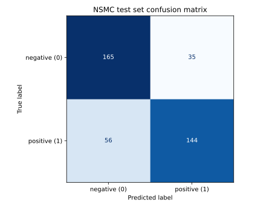

# NSMC 문서 검색·분류 실습 기록

## 1. 데이터 살펴보기

### 목적

전처리 전에 원본 리뷰의 열, 레이블 의미와 분포, 빈 리뷰 및 중복 여부를 확인한다. 이 단계에서는 데이터를 수정하거나 모델을 학습하지 않는다.

### 데이터와 실행 방법

- 출처: [NSMC 원본 저장소](https://github.com/e9t/nsmc)
- 사용 파일: `ratings_train.txt` (탭으로 구분된 `id`, `document`, `label` 열)
- 레이블: `0`은 부정, `1`은 긍정

### 관찰 결과

`ratings_train.txt`를 직접 실행해 확인한 결과:

| 항목 | 결과 |
| --- | ---: |
| 전체 리뷰 | 150,000개 |
| 부정 (`0`) | 75,173개 |
| 긍정 (`1`) | 74,827개 |
| 빈 리뷰 | 5개 |
| 텍스트·레이블이 모두 같은 중복 | 3,656개 |
| 텍스트는 같고 레이블은 다른 추가 리뷰 | 157개 |

처음 집계한 텍스트 기준 중복 3,813개는 위의 두 경우를 합친 값이다. `id`가 달라도 텍스트와 레이블이 같으면 동일 레이블 중복으로 세었다. 빈 리뷰는 중복 집계에서 제외했다. 같은 텍스트에 두 레이블이 모두 붙은 고유 문장은 157개다. 이 절의 수치는 **정제 전 원본 데이터**를 살펴본 결과다.

두 레이블의 수는 거의 같아서, 이후 분류 성능을 볼 때 클래스 불균형은 큰 문제가 아닐 것으로 예상한다. 다만 텍스트만 읽고 직관적으로 판단한 감성과 레이블이 달라 보이는 예시도 있어, 오분류 분석 때 다시 살펴볼 필요가 있다.

예시: 부정 `아 더빙.. 진짜 짜증나네요 목소리` / 긍정 `액션이 없는데도 재미 있는 몇안되는 영화`

## 2. 중복 처리 기준 조사 및 결정

- [NSMC 공식 README](https://github.com/e9t/nsmc)는 레이블이 원래 평점에서 만들어졌다는 점과 데이터 분할을 설명하지만, 중복·상충 레이블의 처리 방법은 지정하지 않는다.
- [중복 데이터에 관한 EMNLP 2024 연구](https://aclanthology.org/2024.emnlp-main.694.pdf)는 기존 분류 데이터에서 레이블이 일치하는 중복은 하나만 남기고, 레이블이 충돌하는 텍스트는 신뢰할 만한 재주석이 없다면 모두 제외할 것을 제안한다. 이는 NSMC 자체의 공식 규칙은 아니다.
- [scikit-learn의 데이터 누출 가이드](https://scikit-learn.org/stable/common_pitfalls.html)는 평가 데이터를 모델 학습에 사용하지 말고, 데이터로부터 학습하는 변환은 학습 데이터에만 맞추라고 설명한다. 같은 리뷰가 학습·평가 양쪽에 있으면 처음 보는 리뷰에 대한 성능을 평가하기 어렵다.

**결정:** 원본 파일은 보존한다. 분류 실험용 데이터에서는 빈 리뷰를 제외하고, 원문 텍스트·레이블이 같은 중복은 첫 번째 리뷰 한 건만 남긴다. 동일 원문에 두 레이블이 모두 붙은 157개 그룹은 임의로 다수결하지 않고 해당 그룹의 모든 행을 제외한다. 이 결정은 레이블의 옳고 그름을 단정한 것이 아니라, 동일한 입력에 두 정답을 요구하지 않도록 하기 위한 것이다.

**이후 분류 평가 원칙:** 정제된 데이터에서 8:2로 분할하고, TF-IDF 어휘와 IDF는 학습 부분에서만 계산한다. 검색용 문서 목록은 레이블이 필요 없으므로 원문 텍스트당 첫 번째 ID 한 건만 남긴다. 검색 단계에서 이 기준을 적용했다.

## 3. 전처리 파이프라인 실습

### 기준과 이유

1. **정제:** 영문은 소문자로 바꾸고, 한글 음절·자모, 영문, 숫자, 공백만 남긴다. 나머지 문자는 공백으로 바꾼 뒤 연속 공백을 합친다. `ㅋㅋ`, `ㅠㅠ` 같은 자모 표현은 보존한다. 구두점·이모지를 제거하면 감성 정보가 사라질 가능성이 있으므로 이후 오분류 분석에서 확인한다.
2. **형태소 분석:** KoNLPy의 `Okt.pos(norm=True, stem=True)`로 형태소와 품사를 얻는다. [KoNLPy 공식 문서](https://konlpy.org/ko/latest/api/konlpy.tag/)에 따르면 `Okt`는 Open Korean Text를 감싼 분석기이며 정규화·어근화 옵션을 제공한다. [Open Korean Text 공식 저장소](https://github.com/open-korean-text/open-korean-text)는 이 프로젝트가 **Twitter 한국어 처리기의 공식 포크**이고, 트윗을 포함한 비정형 한국어의 정규화·토큰화를 지원한다고 설명한다. NSMC의 짧고 비정형적인 리뷰에도 이 기능이 맞을 것으로 판단해 선택했다. SNS 전용 도구라는 뜻은 아니다.
3. **불용어:** [NSMC 공식 README](https://github.com/e9t/nsmc)는 영화 리뷰 전용 불용어 목록을 제공하지 않는다. [stopwords-iso 한국어 목록](https://github.com/stopwords-iso/stopwords-ko/blob/master/stopwords-ko.txt)을 후보 자료로 보되 통째로 적용하지 않는다. 이 목록에는 `아니`, `그러나`처럼 감성 해석에 영향을 줄 수 있는 표현도 있다. [scikit-learn 가이드](https://scikit-learn.org/stable/modules/feature_extraction.html#using-stop-words)도 범용 목록의 단어가 과제에 따라 중요한 특징일 수 있고 토큰화 결과와 목록이 일치해야 한다고 주의한다. 이번에는 `Okt`가 `Josa`로 분석한 `은, 는, 이, 가, 을, 를, 의, 에, 에서, 에게, 와, 과`만 제거한다. 같은 글자가 명사·동사 등으로 분석되면 유지한다.
4. **영화 리뷰 문맥:** `영화`, `리뷰`, `평점`, `배우`, `감독` 같은 도메인 단어를 불용어로 지정하지 않는다. 검색에서는 이런 단어가 주제 단서가 될 수 있고, 지나치게 흔한 단어의 가중치는 이후 TF-IDF의 IDF가 낮춘다. 분류 성능을 기준으로 한 추가 제거 여부는 학습 데이터에서만 검토한다. 부정·반전 표현과 감성 어휘도 보존한다. 영화 리뷰의 `없다` 구문이 극성에 영향을 준다는 [한국어 영화 리뷰 연구](https://www.kci.go.kr/kciportal/landing/article.kci?arti_id=ART002439283)가 그 근거 중 하나다.

코드: `Q4_1/preprocess_nsmc.py`. 실행 전 저장소 루트에서 `python3 -m venv Q4_1/.venv`, `Q4_1/.venv/bin/pip install -r Q4_1/requirements.txt`를 실행한다. 한 문장 확인: `Q4_1/.venv/bin/python Q4_1/preprocess_nsmc.py --text '이 영화는 재미없다 ㅋㅋ'`. 전체 데이터: `Q4_1/.venv/bin/python Q4_1/preprocess_nsmc.py` (데이터가 없으면 먼저 `python3 Q4_1/explore_nsmc.py --download`). 원본 파일은 수정하지 않고 메모리에서 처리한다.

### 실행 결과

| 처리 단계 | 제외된 리뷰/행 |
| --- | ---: |
| 원본 | 150,000개 |
| 빈 리뷰 | 5개 |
| 레이블 충돌: 157개 원문 그룹 | 1,451개 |
| 충돌하지 않는 그룹의 동일 원문·레이블 중복 | 2,519개 |
| 형태소 분석·불용어 제거 후 토큰 없음 | 102개 |
| **최종 사용 가능 리뷰** | **145,923개** |

최종 레이블 분포는 부정 73,213개, 긍정 72,710개다. 제거된 조사 토큰은 214,040개다. 앞 절의 동일 레이블 중복 3,656개는 **원본 전체**에서 발견한 값이고, 여기의 2,519개는 충돌 그룹을 먼저 제외한 뒤 실제로 추가 제거된 값이다. 따라서 표의 제외 건수는 서로 겹치지 않는다.

한 문장 확인에서는 `이 영화는 재미없다 ㅋㅋ`가 `이/Noun`, `영화/Noun`, `는/Josa`, `재미없다/Adjective`, `ㅋㅋ/KoreanParticle`로 분석되었고, 조사 `는`만 제거되었다. `영화 리뷰 배우 감독`은 모두 유지되며, `그 영화는 평점이 안 좋아서 못 보겠어`에서도 `안`, `못`은 유지된다.

첫 원본 예시 `아 더빙.. 진짜 짜증나네요 목소리`는 `아, 더빙, 진짜, 짜증나다, 목소리`로 분석되었다. 반면 띄어쓰기와 철자가 모두 불안정한 `너무재밓었다그래서보는것을추천한다`는 `너, 무재, 밓었, 다그, 래서, 보다, 추천, 한, 다`처럼 부정확하게 분절됐다. `Okt`를 적용해도 모든 리뷰가 정확히 분석되는 것은 아니다. 구두점과 이모지 제거가 감성 분류에 미치는 영향도 아직 검증하지 않았다.

## 4. TF-IDF 직접 구현과 검증

### 계산 방법

`Q4_1/numpy_tfidf.py`에서 형태소 토큰의 정렬된 어휘를 만들고 NumPy 행렬에 문서별 원시 출현 횟수(TF)를 기록했다. `Q4_1/tfidf_nsmc.py`는 이 구현을 scikit-learn과 비교한다. `df(t)`는 단어 `t`가 한 번 이상 등장한 **문서 수**다. 이후 [scikit-learn 공식 수식](https://scikit-learn.org/stable/modules/feature_extraction.html#tf-idf-term-weighting)에 맞춰 다음을 계산했다.

```text
TF(t, d) = 문서 d에서 t의 출현 횟수
IDF(t) = log((1 + N) / (1 + df(t))) + 1
TF-IDF(t, d) = TF(t, d) × IDF(t)
최종 벡터 = TF-IDF 문서 벡터 / 해당 벡터의 L2 길이
```

`N`은 TF-IDF를 학습하는 문서 수다. `+1`을 분자와 분모에 적용하는 것은 `smooth_idf=True`와 일치시키기 위해서다. 반복된 단어의 TF에는 로그를 적용하지 않으며(`sublinear_tf=False`), 각 문서 벡터를 L2 정규화한다. `fit`에서 만든 어휘와 IDF를 `transform`에서도 그대로 사용한다.

### 검증 설정

- 정제된 145,923개 리뷰에서 `random_state=42`로 부정 500개·긍정 500개를 추출했다. NumPy 구현이 **조밀한 행렬**을 사용하므로 전체 14만여 건을 한 번에 벡터화하지 않고, 과제의 최소 500문서 조건을 넘는 1,000개로 계산 검증을 했다.
- 양쪽에 **같은 Okt 토큰**을 전달했다. scikit-learn에는 `analyzer=str.split`과 직접 만든 어휘를 설정해 기본 토큰 패턴에 의한 한 글자 토큰 누락이나 열 순서 차이를 막았다.
- scikit-learn 설정: `lowercase=False`, `use_idf=True`, `smooth_idf=True`, `sublinear_tf=False`, `norm='l2'`, `dtype=float64`. [각 옵션의 정의](https://scikit-learn.org/stable/modules/generated/sklearn.feature_extraction.text.TfidfVectorizer.html)를 확인하고 직접 구현과 맞췄다.
- 이 표본에서 IDF를 학습한 것은 **두 구현의 수치 일치 검증용**이다. 이후 분류 실험에서는 학습 데이터에서만 어휘와 IDF를 학습한다.

### 실행 결과

실행: `Q4_1/.venv/bin/python Q4_1/tfidf_nsmc.py` · 원본 로그: [tfidf_validation.log](tfidf_validation.log)

| 항목 | 결과 |
| --- | ---: |
| TF-IDF 행렬 크기 | 1,000 × 3,346 |
| IDF 최대 오차 | 0 |
| TF-IDF 행렬 최대 오차 | 1.110223024625e-16 |
| TF-IDF 행렬 평균 오차 | 4.028125379244e-20 |
| 허용 오차 | 1e-6 |
| 판정 | **PASS** |

NumPy 2.4.6, scikit-learn 1.9.1에서 확인했다. 이 결과는 **선택한 1,000개 문서와 명시한 설정에서 수치가 일치한다**는 뜻이며, 검색 품질이나 분류 성능을 보증하지는 않는다.

## 5. 코사인 유사도 기반 리뷰 검색

### 구현과 범위

`Q4_1/main.py`는 원본 NSMC 학습 파일에서 빈 리뷰를 제외하고 **원문 텍스트당 첫 번째 ID**만 유지한다. 검색은 감성 레이블을 사용하지 않으므로 레이블이 충돌한 원문도 한 건의 문서로 취급한다. 중복을 정리한 뒤 고정 시드 `42`로 순서를 섞고, Okt 전처리 후 토큰이 남는 리뷰 **2,000개**를 검색 대상으로 삼는다. 이는 최소 500문서 조건을 넘는다. 현재 NumPy TF-IDF 구현이 조밀한 행렬을 쓰므로 **전체 145,923개를 검색하는 구현은 아니다.**

문서 2,000개로 어휘·IDF를 `fit`하고 문서 벡터를 만든다. 사용자가 입력한 쿼리는 같은 `preprocess_text` 함수를 거쳐, **이미 학습한 어휘·IDF로 `transform`**한다. 점수는 NumPy 행렬곱과 벡터 길이로 직접 계산한다.

```text
cosine(문서, 쿼리) = (문서 벡터 · 쿼리 벡터) / (||문서 벡터|| × ||쿼리 벡터||)
```

점수가 양수인 문서 중 상위 5개를 점수, 문서 ID, 원문 스니펫과 함께 출력한다. 쿼리 토큰이 어휘에 없으면 빈 결과를 반환한다. 실행 예시는 다음과 같다.

```bash
Q4_1/.venv/bin/python Q4_1/main.py --query '배우들의 연기가 훌륭하다' --topk 5
```

### 실행 결과와 관찰

검색 문서 2,000개에서 어휘는 5,118개였다. 위 쿼리는 `배우, 들, 연기, 훌륭하다`로 토큰화되었다.

| 순위 | 코사인 점수 | 문서 ID | 리뷰 스니펫 |
| ---: | ---: | --- | --- |
| 1 | 0.361903 | 6758524 | 배우들은 매력적이었다 |
| 2 | 0.349816 | 5711325 | 배우가 아깝다. |
| 3 | 0.340131 | 9640025 | 탄탄한 스토리 ,훌륭한 배우연기,눈이 호강할 액션그리고 놀랄 반전이 있는 모든 장점을 모아두는것 같은 영화다 |
| 4 | 0.311136 | 140534 | 좋지도 않고 나쁘지도않다. 하지만 배우들의 연기에 감동해서 점수를 준다. |
| 5 | 0.298883 | 9706100 | 솔직히 재미있다. 스토리도 괜춘하고.. 배우들의 연기도 참 좋은거 같은데;; |

`zzzzzzunknownword`처럼 어휘에 없는 쿼리는 결과를 반환하지 않았다. `연기가 좋다`는 `좋아요` 같은 짧은 리뷰가 상위에 올랐다. 짧은 문서는 한 단어의 비중이 커지고, BoW 코사인 유사도는 질의의 모든 단어를 포함했는지나 문장의 의미를 직접 판단하지 않기 때문이다. 이 사례는 이후 검색 품질 개선 방향을 논의할 근거로 남긴다.

## 6. TF-IDF 기반 감성 분류

### 실험 설계

`Q4_1/classify_nsmc.py`에서 NSMC 원문을 기준으로 중복을 정리했다. 같은 원문·레이블은 첫 행만 남기고, 레이블이 충돌하는 157개 원문 그룹은 모두 제외했다. 부정·긍정 리뷰를 각각 1,000개씩 고정 시드 `42`로 추출한 뒤 Okt로 전처리하고, 레이블 비율을 유지하며 **Train 1,600개 / Test 400개**로 나눴다. 검색용 2,000개와는 별도로 뽑은 분류 표본이다.

직접 구현한 NumPy TF-IDF의 어휘와 IDF는 **Train에서만 `fit`**했다. Test에는 같은 어휘·IDF로 `transform`만 적용하여 평가 정보가 학습에 섞이지 않도록 했다. 분류기는 scikit-learn `LogisticRegression(max_iter=1000, random_state=42)`이고, 정확도와 macro F1을 계산했다. 레이블 `0`은 부정, `1`은 긍정이다.

실행: `Q4_1/.venv/bin/python Q4_1/classify_nsmc.py` · 원본 결과: [classification_validation.log](classification_validation.log)

| 항목 | 결과 |
| --- | ---: |
| Train 어휘 | 4,609개 |
| 정확도 | 0.772500 |
| Precision (macro) | 0.775538 |
| Recall (macro) | 0.772500 |
| F1-Score (macro) | 0.771871 |
| 오분류 | 91 / 400개 |

혼동 행렬은 **행이 실제, 열이 예측**이며 레이블 순서는 `0, 1`이다.

| 실제 \ 예측 | 부정 (0) | 긍정 (1) |
| --- | ---: | ---: |
| 부정 (0) | 165 | 35 |
| 긍정 (1) | 56 | 144 |



오분류 91개와 정분류 309개에서 다음 **관찰 신호**를 비교했다. 항목은 서로 중복될 수 있으며, 비율 차이가 곧 인과관계나 개선 효과를 뜻하지는 않는다. `부정 표현`은 토큰 `안, 못, 아니다, 않다, 없다` 중 하나가 포함된 경우다.

| 관찰 신호 | 오분류 | 정분류 |
| --- | ---: | ---: |
| Train 어휘에 없는 토큰 포함 | 68/91 (74.7%) | 191/309 (61.8%) |
| 토큰 3개 이하 | 15/91 (16.5%) | 32/309 (10.4%) |
| 부정 표현 토큰 포함 | 21/91 (23.1%) | 58/309 (18.8%) |

### 오분류 사례 5개

아래 `기여`는 해당 리뷰의 **TF-IDF 값 × Logistic Regression 계수**다. 양수는 긍정, 음수는 부정 예측 쪽으로 점수를 밀어준다. 이는 모델이 실제로 사용한 단어별 근거이며, 원문의 진짜 감성이나 레이블 오류를 확정하는 증거는 아니다.

1. **`20년이 훨씬 지난 영화인데도 개쩌는 긴장감`** (실제 긍정 → 예측 부정): 강한 긍정 표현 `개쩌`가 Train 어휘에 없어 벡터에서 빠졌다. `도`(-0.135), `20년`(-0.097), `이`(-0.093)의 음수 기여가 `긴장감`(+0.121)을 눌렀다. 신조어 미등록과 단어별 가중치의 한계가 함께 나타난다.
2. **`이영화 볼만함`** (실제 긍정 → 예측 부정): Okt가 `볼, 만, 함`으로 분리했다. 전체 표현은 볼 만하다는 긍정 의미지만, 이 표본에서 `만`은 -0.260으로 가장 큰 부정 기여를 했다. BoW는 분리된 형태소 사이의 결합 의미를 직접 표현하지 않는다.
3. **`그것이 알고싶다짱`** (실제 부정 → 예측 긍정): `짱`이 +0.962로 강하게 작용했고 `알고싶다`는 어휘에 없었다. 원문만 보면 레이블 `0`의 이유가 분명하지 않아, 맥락 부족이나 레이블의 모호성도 가능한 설명이다. 이 한 건으로 원본 레이블이 틀렸다고 단정할 수는 없다.
4. **`아주 유쾌함`** (실제 긍정 → 예측 부정): `유쾌하다`는 어휘에 있지만 학습된 기여가 -0.053, `아주`도 -0.104였다. 짧은 문장에는 다른 감성 단서가 거의 없고, 작은 학습 표본에서 얻은 단어 가중치가 실제 문장의 감성과 어긋난 사례다.
5. **`8점대 받을 만큼 잘 만든 액션 영화는 아니라고 생각한다.`** (실제 부정 → 예측 긍정): 부정 표현 `아니다`는 제거되지 않았고 -0.313으로 작용했다. 그러나 `액션`(+0.328), `만큼`(+0.241), `생각`(+0.237) 등이 더해져 긍정으로 예측됐다. `아니다`가 앞의 `잘 만든` 전체를 부정한다는 관계는 BoW 벡터에 직접 담기지 않는다. `잘`이 `자다`로 분석된 전처리 오차도 보인다.

이 결과는 2,000개 표본으로 학습한 기본선 성능이다. 전체 NSMC 성능으로 일반화할 수 없고, 더 큰 학습 자료·다른 표본 또는 n-gram 등을 비교해야 각 오류 원인의 영향을 정량적으로 확인할 수 있다.

## 7. 평가 후 개념 보완

### 코사인 정규화와 거리

`q=(1,1)`, `a=(10,10)`, `b=(1,0)`일 때 원시 내적은 `q·a=20`, `q·b=1`이고, 원시 유클리드 거리는 `q`에서 `a`까지 약 `12.73`, `b`까지 `1`이다. 단순 내적은 문서 벡터가 큰 `a`를 선호하고 원시 유클리드 거리는 크기가 가까운 `b`를 선호한다. 코사인은 길이로 나누어 `a=1`, `b≈0.707`이므로 **같은 단어 비율**에 가까운 `a`를 찾는다. 문서와 쿼리를 모두 L2 정규화했다면 `||q-d||²=2-2cos(q,d)`라서 유클리드 거리와 코사인 유사도의 순위는 같다. 검색 코드가 정규화된 TF-IDF 벡터를 쓰면서 분모를 다시 계산하는 것은 수식을 명시적으로 구현한 것이다.

### 다의어가 합쳐지는 사례

원본 NSMC에는 `사과가 썩는 것은 사과 잘못이 아니다`(id `9190813`, 과일)와 `사과 한 마디 받기 참 힘든 세상!`(id `10276456`의 첫 부분, 사죄)이 있다. 두 문장을 실제 전처리 함수에 넣었을 때 모두 `사과`가 토큰으로 나왔다. 따라서 현재의 어휘 한 칸은 두 의미를 구별하지 않는다. 이것이 이 두 리뷰의 오분류를 일으켰다는 주장은 아니며, **표현 방식의 한계**를 확인한 사례다. 영향도를 조사하려면 `사과`가 나온 문서의 주변 단어를 모으고 사람이 의미를 표기한 뒤, 의미별 검색·분류 오류를 비교해야 한다. 문맥 임베딩 또는 단어 의미 중의성 해소(WSD)는 이후 대안이다.

### 다른 데이터와 100만 문서로 확장한다면

현재 파일 로더는 `id/document/label`을 가진 NSMC TSV, 전처리는 한국어 Okt, 분류는 0/1 레이블을 전제한다. 다른 한국어 도메인에서는 불용어·구두점 기준을 재검토하고, 영어 자료라면 토큰화·표제어 처리기를 바꿔야 한다. 레이블이 없으면 검색 실험은 가능하지만 분류 평가는 할 수 없다. 새 데이터에서는 어휘와 문서 빈도가 바뀌므로 해당 학습 부분에서 TF-IDF를 다시 `fit`해야 한다.

검색 표본 `2,000 × 5,118`의 `float64` 조밀 행렬 한 개는 약 `81.9 MB`다. `1,000,000 × 50,000`이면 한 행렬만 약 `400 GB`이고 임시 배열은 별도다. 실제 확장 설계에서는 0이 아닌 값만 저장하는 희소 행렬, 쿼리 토큰에 해당하는 문서만 찾는 역색인, 신규 문서용 증분 색인과 주기적 병합을 검토한다. 신규 문서가 늘면 전역 `df`·`IDF`가 달라져 갱신 정책도 필요하다. 단일 장비가 부족한 경우 문서별 샤드의 상위 결과를 합칠 수 있다. 이 수치는 **조밀 행렬의 이론적 크기**이고, 대안의 속도 향상은 아직 측정하지 않았다.

후속 비교에서는 분류 Train/Test 분할을 고정하고 1-gram 대비 1+2-gram의 **macro F1 변화**를 측정한다. 검색은 질의와 사람이 판정한 관련 문서 집합을 준비해 **Precision@5**를 비교한다. NSMC의 긍정·부정 레이블만으로는 특정 검색어에 대한 문서 관련도를 알 수 없다.
