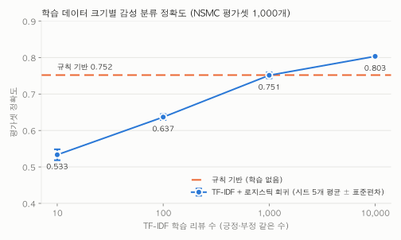

# 규칙 기반 정보 추출·감성 분석

고객 문의에서 이메일·전화·날짜·금액·URL을 **정규표현식**으로 추출하고, **감성 사전**으로 만족·불만을 판정하는 규칙 기반 파이프라인이다. 보너스 과제 3개(개인정보 마스킹, 규칙 vs TF-IDF 비교, Aspect 감성 분석)를 모두 구현했다.

- 단계별 작업 기록과 판단 근거: [docs/REPORT.md](docs/REPORT.md)
- 발표용 요약: [docs/summary.md](docs/summary.md)
- 설계·계획: [docs/PLAN.md](docs/PLAN.md), 문제: [docs/PROBLEM.md](docs/PROBLEM.md)

## 1. 프로젝트 개요

```text
고객 문의 ─┬─ patterns.py → extractor.py ─── 추출·정규화 ──── masking.py (보너스)
           └─ lexicon.py  → sentiment.py ─── 감성 점수 ───── aspect.py  (보너스)
main.py: 두 흐름을 합친 CLI
```

| 요구사항 | 모듈 | 결과 |
| --- | --- | --- |
| 5개 패턴 추출, 패턴별 3변형 이상, 정규화 | `patterns.py`, `extractor.py` | 표기별 규칙 14개, ISO 8601·정수·하이픈 통일 |
| 감성 사전 200개 이상, 도메인어 30개 이상 | `lexicon.py`, `data/*_lexicon.tsv` | 285개 (도메인 59개), 직접 구축 |
| 감성 점수, 부정어·강조어·이중부정 | `sentiment.py` | 계산 과정 출력(trace) 포함 |
| 테스트 문장 50개 이상, 패턴별 P/R, 실패 5건 이상 | `extraction_testset.py`, `evaluate_extraction.py` | 115문장 + 독립 홀드아웃 40문장, 실패 10건 분석 |
| 레이블 100개 이상, Acc·F1, 규칙 전후 비교, 오분류 10건 이상 | `nsmc_data.py`, `evaluate_sentiment.py` | NSMC test 1,000개, 오분류 20건 분석 |
| [보너스] 개인정보 마스킹 | `masking.py` | 주민번호·카드·주소 추가, 누출 검사 |
| [보너스] 규칙 vs TF-IDF | `compare_tfidf.py` | 학습 데이터 10/100/1,000/10,000개 비교 |
| [보너스] Aspect 감성 분석 | `aspect.py` | 측면 9개, 독립 평가셋 36문장 |

## 2. 설치 및 실행 방법

Python 3.10 이상과 Java(JDK, KoNLPy의 Okt가 사용)가 필요하다.

```bash
cd Q4_2
python -m venv .venv && source .venv/bin/activate
pip install -r requirements.txt
python nsmc_data.py --download        # NSMC 원본 받기 (최초 1회, Git 제외)

python main.py --text '문의: support@company.co.kr, 전화 02-1234-5678 일시: 2024년 3월 15일, 참가비: 50,000원'
python main.py --text '음식은 맛있는데 가격이 비싸요' --aspect
python main.py --text '본인 확인 881231-1234567, 연락처 010-1111-2222' --mask
```

출력 예 (`python main.py --text '이 식당은 정말 맛있지 않았어요'`의 감성 부분):

```text
1. 토큰화: [이, 식당, 은, 정말, 맛있다, 않다]
2. 감성 단어 탐지: 맛있다(+2)
4. 부정어 탐지: '않다' → '맛있다' 반전
5. 강조어 탐지: '정말' → '맛있다' ×1.5
계산: (+2) × (-1) × 1.5 = -3
최종 판정: 부정
```

| 평가 재현 | 명령 | 결과 파일 |
| --- | --- | --- |
| 테스트 문장 생성 | `python extraction_testset.py` | `data/extraction_testset.jsonl` |
| 정보 추출·개인정보·마스킹 | `python evaluate_extraction.py` | `docs/extraction_eval.log` |
| 감성 사전 확인 | `python lexicon.py --check` | — |
| 감성 분석 | `python evaluate_sentiment.py` | `docs/sentiment_eval.log` |
| 규칙 vs TF-IDF | `python compare_tfidf.py` | `docs/rule_vs_tfidf.log`, `.svg` |
| Aspect | `python aspect.py --evaluate` | `docs/aspect_eval.log` |

## 3. 데이터 구성

| 데이터 | 파일 | 크기 | 만든 방법 |
| --- | --- | ---: | --- |
| 정보 추출 개발셋 | `data/extraction_testset.jsonl` | 115문장 | 직접 작성. 패턴별 12문장, 오탐 유도 11, 복합 문의 20(템플릿 조합), 개인정보 24 |
| 정보 추출 홀드아웃 | `data/extraction_holdout.jsonl` | 40문장 | 패턴 코드를 보지 않은 별도 에이전트가 정규화 규격만 받고 작성 |
| 개인정보 홀드아웃 | `data/pii_holdout.jsonl` | 25문장 | 위와 같은 방식 |
| Aspect 평가셋 | `data/aspect_testset.jsonl` | 36문장 | 위와 같은 방식 (식당·쇼핑·영화 각 12) |
| 감성 레이블 | [NSMC](https://github.com/e9t/nsmc) | 1,000 / 1,000 / 20,000 | test 평가셋 / train 개발셋 / train 사전 후보 풀. 모두 긍정·부정 같은 수 |
| 감성 사전 | `data/sentiment_lexicon.tsv`, `data/domain_lexicon.tsv` | 226 + 59 | 직접 구축 (4.2 참고) |

- 정답은 사람이 판단하는 기준으로 적었다. 규칙이 놓칠 표기(한글 숫자 등)도 정답에 넣어 재현율의 한계가 수치에 드러나게 했다.
- 개발셋은 규칙과 같은 사람이 써서 점수가 좋게 나올 수 있다. 그래서 홀드아웃을 따로 두고, 홀드아웃을 보고는 규칙을 고치지 않았다.
- 감성 사전과 규칙은 train에서만 조정했다. test는 마지막에 한 번만 돌렸다.

## 4. 규칙 설계

### 4.1 정규표현식

모든 패턴은 `re.VERBOSE`로 쓰고, 줄마다 의도를 주석으로 달았다. 각 패턴 위에는 매칭하는 범위와 제외하는 범위를 적었다([patterns.py](patterns.py)).

| 유형 | 처리하는 변형 | 정규화 |
| --- | --- | --- |
| 이메일 | 서브도메인·국가 도메인, `+`태그, 대문자, 꺾쇠·괄호·조사 경계 | 소문자 |
| 전화 | 휴대폰·지역·070, 하이픈·점·공백·무구분, `(02)`, `+82`, 15xx 대표번호 | `010-1234-5678` |
| 날짜 | `2024년 3월 15일`, `/`·`-`·`.`, 영문 월, `3월 15일`, `2024년 5월` | `2024-03-15`, `--03-15`, `2024-05` |
| 금액 | `10,000원`, `1억 2천만원`, `1만 5천원`, `₩`, `$`, `달러`, `USD` | 정수 + 통화(KRW/USD) |
| URL | http(s), 스킴 없는 `www.`, 포트·쿼리·프래그먼트, 끝 문장부호·조사 제외 | 스킴·호스트 소문자, `https://` 보충 |
| [보너스] 주민번호·카드·주소 | 하이픈·공백·무구분, AMEX, 도로명·지번·상세주소 | `YYMMDD-NNNNNNN`, `4-4-4-4` |

- **경계:** 파이썬 `re`는 한글도 단어 문자로 보기 때문에 `\b`가 `co.kr입니다`의 경계를 찾지 못한다. ASCII 문자 집합을 명시한 전후방 탐색으로 경계를 잡았다.
- **역할 분담:** 정규식은 형식만 맞는 후보를 찾고, 2월 30일·13월 같은 달력상 유효성은 정규화 단계(`datetime`)에서 거른다.
- **겹침:** 후보가 겹치면 긴 쪽을 남긴다. URL 속 날짜나 카드번호 속 전화번호 같은 부분 매칭이 이렇게 걸러진다.

### 4.2 감성 사전

- 총 285개다. 점수는 -2~+2 정수다.
- **범용 226개:** 직접 고르고 점수를 매겼다.
- **영화 도메인 59개:** NSMC train 2만 개에서 긍정·부정 리뷰 문서 수를 비교해 한쪽에 치우친 단어 중에서 골랐다(`docs/lexicon_candidates.tsv`). 예: `꿀잼`, `노잼`, `발연기`, `명작`, `비추`, `별 반개`. 통계로 고른 단어는 note에 근거 수치를 남겼다.
- **도메인에서 극성이 바뀌는 단어:** `슬프다`, `눈물`, `ㅠㅠ`는 영화 리뷰에서 감동 표현이라 긍정으로 넣었다(예: `슬프다` 긍정 147 vs 부정 23).
- **표기:** 표제어는 Okt 원형에 맞췄다. `lexicon.py --check`가 모든 표제어가 실제 토큰으로 나오는지 확인한다.
- **출처:** 외부 사전은 쓰지 않았다. 데이터 출처는 NSMC(e9t/nsmc)다.

### 4.3 부정어·강조어·이중부정

[sentiment.py](sentiment.py)의 처리 순서는 `토큰화 → 감성어 → 이중부정 → 부정어 → 강조어 → 합산`이다.

| 규칙 | 내용 | 예 |
| --- | --- | --- |
| 뒤 부정어 | `않다·없다·아니다·못하다`가 앞 2토큰 안의 감성어를 반전 | `맛있지 않다`, `좋은 영화는 아니다` |
| 앞 부정어 | `안·못`은 바로 다음 말만 반전. `명사 + 못 하다`이면 명사를 반전 | `안 좋다`, `공감 못 하다` |
| 부정 결합어 | `별로·어이·그닥` 등은 이미 부정 뜻이라 반전하지 않음 | `별로 없다` |
| 강조어 | 감성어 앞의 `정말·너무 ×1.5`, `조금·좀 ×0.5` | `정말 맛있다` |
| 이중부정 | 부정어 두 개가 `수·것`만 사이에 두고 이어지면 상쇄 | `감동하지 않을 수 없다` |
| 0점 | 감성어가 없으면 부정 (개발셋 0점 리뷰의 57%가 부정) | — |

## 5. 평가 결과

### 정보 추출 (패턴별 Precision / Recall)

| 패턴 | 개발셋 (115문장) | 홀드아웃 (40문장) |
| --- | ---: | ---: |
| 이메일 | 1.000 / 0.917 | 1.000 / 1.000 |
| 전화 | 1.000 / 0.960 | 1.000 / 0.900 |
| 날짜 | 1.000 / 0.933 | 1.000 / 1.000 |
| 금액 | 1.000 / 0.962 | 1.000 / 1.000 |
| URL | 0.952 / 0.909 | 1.000 / 0.875 |
| 전체 | 0.992 / 0.937 | 1.000 / 0.957 |

### 감성 분석 (NSMC test 1,000개)

| 설정 | Accuracy | Macro F1 |
| --- | ---: | ---: |
| 사전만 | 0.737 | 0.734 |
| +부정어 | 0.751 | 0.748 |
| +강조어 | 0.738 | 0.735 |
| +부정어+강조어+이중부정 (최종) | 0.752 | 0.749 |

전체 수치의 차이가 작은 것은 규칙이 적용되는 리뷰가 적기 때문이다. 부정어가 감성어를 실제로 반전한 리뷰 47개만 보면 정확도가 0.511에서 0.809로 오른다. 이중부정은 NSMC에 거의 없어서(1건) 직접 쓴 확인 문장으로 동작을 검증했다(`docs/sentiment_eval.log`).

### 보너스

| 과제 | 결과 |
| --- | --- |
| 개인정보 (홀드아웃 P / R) | 주민번호 1.000 / 0.875, 카드 1.000 / 0.857, 주소 0.667 / 0.571. 가려야 할 109개 중 8개 누출(모두 추출 단계에서 놓친 것) |
| 규칙 vs TF-IDF | 아래 그래프. 학습 데이터 1,000개에서 두 방법이 같아지고, 10,000개에서 TF-IDF가 0.803으로 앞선다 |
| Aspect (36문장) | 측면 탐지 P 1.000, R 0.797, 극성 정확도 0.979, 문장 완전 일치 0.667 |



사전 감성어가 있는 리뷰에서는 규칙 기반 0.848, TF-IDF(1만 개 학습) 0.857로 비슷하다. 차이는 사전이 닿지 않는 리뷰(37.5%)에서 생긴다(0.592 vs 0.715).

## 6. 실패 사례 분석

자세한 사례는 [REPORT 3·4~6·7·9절](docs/REPORT.md)에 있다.

| 영역 | 원인 | 사례 |
| --- | --- | --- |
| 정보 추출 | 한글 숫자 | `공일공-일이삼사-오육칠팔`, `삼만원`, `이천이십사년 삼월 십오일` |
| 정보 추출 | 문자 변형 | `user at example dot com`, 전각 `user＠example.com` |
| 정보 추출 | 형식만으로 구분 불가 | `24.03.15`(버전과 같음), `example.com/help`(파일명과 같음) |
| 정보 추출 | 의도한 경계의 대가 | `…/wiki/정규_표현식` → `…/wiki/` (조사 분리를 택함) |
| 개인정보 | 주소의 시작·끝 | `테헤란로 152`(시·도 없음), `… 2400 경동아파트 103동 504호`에서 끊김 |
| 감성 | 사전 커버리지 | 오분류 248건 중 158건은 감성어가 하나도 없음 |
| 감성 | 감성 대상 불일치 | `쓰레기 각본도 … 예술로 승화`, `졸작이라니..`(남의 평 반박) |
| 감성 | 대비·시점 | `그 당시엔 재밌었지만...` |
| 감성 | 반어 | `1시간 27분에 끝내줘서 감사할 따름` |
| 감성 | 강조 부사 오인 | `재미도 드럽게 없네` (`드럽게` = 매우) |
| 감성·Aspect | 형태소 분석 오류 | `잘 보고` → `자다 보다`, `됐다` → `돼다`(부정 규칙 미작동), `빨라서` → `빨 + 라서` |

## 7. 개선 아이디어 및 한계 분석

**규칙 기반의 성격.** 잡은 것은 거의 맞는다(정보 추출 정밀도 약 1.0, Aspect 탐지 정밀도 1.0). 대신 규칙을 만든 사람이 예상한 표기만 잡는다. 놓친 사례는 규칙 하나로 고칠 수 있지만, 고칠 때마다 다른 표기와 충돌하는지 다시 확인해야 한다. 재현율을 올리는 비용이 곧 유지보수 비용이다.

**개선 아이디어**
- 정보 추출: 한글 수사를 숫자로 바꾸는 전처리, NFKC 유니코드 정규화(전각 문자), 카드번호 룬(Luhn) 검사(실데이터에서 정밀도 상승)
- 감성 사전: 후보 통계에서 반자동으로 확장하되 사람이 검수. `드럽게` 같은 강조 부사 목록 추가
- 문맥: 대비 접속(`-지만`, `근데`) 뒤 절에 가중치를 주는 규칙. 다만 반어와 감성 대상은 단어 규칙으로 풀기 어렵다
- 혼합 방식: 사전 감성어가 있으면 규칙으로, 없으면 TF-IDF로 판정. 8절 결과에서 두 방법이 강한 영역이 서로 다르다

**한계**
- Okt 분석 오류(`돼다`, `자다`)는 규칙으로 보완하기 어렵다. 평가 데이터에서 찾은 문제라 평가 수치를 지키기 위해 고치지 않고 기록만 했다.
- 홀드아웃과 Aspect 평가셋도 LLM이 작성했다. 실제 사용자 문장보다 표기가 정돈되어 있을 수 있다.
- 감성 평가는 영화 리뷰(NSMC) 기준이다. 고객 문의 도메인에서는 사전을 다시 맞춰야 한다.

**통계 기반(Mission 1)과 규칙 기반(이번 과제)의 비교**

| | 규칙 기반 | 통계 기반 (TF-IDF) |
| --- | --- | --- |
| 필요한 것 | 사람의 규칙·사전 | 레이블 데이터 (1,000개 이상에서 규칙과 같아짐) |
| 강점 | 형식이 정해진 정보(이메일, 날짜), 높은 정밀도, 판정 근거 설명 | 다양한 표현, 사전 밖 어휘 |
| 약점 | 재현율, 유지보수, 문맥 | 데이터가 적을 때, 특정 형식의 정확한 추출 |
| 적합한 곳 | 정보 추출, 개인정보 마스킹, 레이블이 없는 초기 단계 | 레이블이 충분한 분류 |
