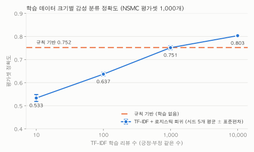

# 규칙 기반 정보 추출·감성 분석 실습 기록

단계별로 한 일과 판단 근거를 남긴다. 전체 계획은 [PLAN.md](PLAN.md)에 있다.

## 1. 설계와 테스트 문장 생성

### 한 일

- 모듈 구조와 10단계 계획을 [PLAN.md](PLAN.md)에 정리했다. Q4_1처럼 모듈을 한 폴더에 두고 각자 CLI로 실행한다.
- 추출 결과와 정답을 같은 자료형 `Entity`로 표현했다. (`entities.py`)
- 테스트 문장 생성기를 만들었다. (`extraction_testset.py` → `data/extraction_testset.jsonl`)

### 결정

- **정규화 값으로 채점한다.** `Entity.key() = (유형, 정규화 값, 통화)`로 비교한다. `+82-10-…`과 `010-…`처럼 표기가 달라도 같은 번호면 정답이다. 정규화를 잘못하면 오답으로 잡힌다.
- **정규화 규격을 먼저 정했다.** 생성기 정답과 추출기가 같은 규격을 따라야 한다. 아래 세 가지는 판단이 필요했다.
  - 연도 없는 `3월 15일`은 `--03-15`, 일 없는 `2024년 5월`은 `2024-05`로 둔다(ISO 8601 축약형). 버리지 않고 정보로 본다.
  - 금액은 정수와 통화(KRW/USD)로 나눈다. `$100`과 `100원`을 구분해야 한다.
  - 스킴이 없는 URL에는 `https://`를 붙인다.
- **정답은 직접 적었다.** 생성기가 추출기를 호출하면 추출기의 오류가 정답에 그대로 들어간다.
- **어려운 사례를 일부러 넣었다.** 한글 숫자(`공일공-…`), 난독화 이메일 등 규칙이 놓칠 것으로 예상한 9건에 `hard` 표시를 했다. 재현율의 한계를 수치로 보여 주고, 실패 사례 분석에 쓴다.
- **오탐 유도 문장을 넣었다.** 버전 번호, IP, 없는 날짜(`2024-02-30`)처럼 정답이 없는 문장 11개로 정밀도를 본다.
- **복합 문장은 템플릿으로 조합했다.** 고객 문의처럼 여러 정보가 섞인 문장 20개를 템플릿 6종과 고정 시드로 만든다. 값은 표준 표기만 쓰고, 어려운 변형은 단일 패턴 문장에서 따로 본다.

### 결과

| 분류 | 문장 | 정답 개체 |
| --- | ---: | ---: |
| 단일 패턴 (이메일·전화·날짜·금액·URL) | 각 12 | 각 12~13 |
| 오탐 유도 | 11 | 0 |
| 복합 문의 | 20 | 61 |
| 개인정보 (보너스) | 24 | 22 |
| 합계 | 115 | 146 |

`validate_cases()`는 과제 조건(50문장 이상, 패턴별 10문장·3변형 이상)을 확인한다. 정답 표기가 원문에 실제로 있는지도 검사하며, 조건을 어기면 저장하지 않는다.

실행: `python extraction_testset.py`

## 2. 정규식 패턴과 추출기

### 한 일

- `patterns.py`: 5개 유형을 표기별 규칙 14개로 나눴다. 규칙마다 잡는 표기와 일부러 안 잡는 표기를 주석으로 적었다.
- `extractor.py`: 후보 탐색 → 정규화·검증 → 겹침 정리 순서로 추출한다.

### 결정

- **`\b` 대신 경계를 직접 정의했다.** 파이썬 `re`는 한글도 단어 문자로 본다. 그래서 `co.kr입니다`에서 `kr`과 `입` 사이를 경계로 인식하지 못한다. `(?<![A-Za-z0-9._%+\-])`처럼 ASCII 문자 집합으로 전후방 탐색을 썼다.
- **정규식은 형식만 보고, 유효성은 코드로 검사한다.** `2024-02-30`을 정규식으로 막으려면 월별 일수를 모두 적어야 한다. 대신 `datetime.date()`로 확인한다.
- **겹치면 긴 매칭을 남긴다.** URL 안의 날짜(`https://x.com/2024-03-15/post`)나 카드번호 안의 전화번호 같은 부분 매칭을 버리기 위해서다. 길이가 같으면 유형 우선순위로 고른다.
- **URL에는 ASCII 문자만 허용한다.** `…/item/123에서`의 조사를 떼려면 한글을 빼야 한다. 그 대가로 한글 경로 URL은 중간에서 잘린다. 조사가 붙은 경우가 더 흔하다고 보고 이쪽을 택했다. 괄호도 같은 이유로 뺐다.
- **소수 달러(`$12.50`)는 잡지 않는다.** 금액은 정수로 정규화하므로 반올림 기준이 따로 필요하다. 이번 범위에서 빼고 한계로 남긴다.
- **전화번호 구분자는 통일된 것만 받는다.** 역참조 `(?P=sep)`로 `010-1234 5678`처럼 섞인 표기를 거른다.

### 결과

테스트셋 115문장으로 임시 집계했다. 3단계 평가 모듈로 다시 산출한다.

| 패턴 | 정밀도 | 재현율 |
| --- | ---: | ---: |
| 이메일 | 1.000 | 0.917 |
| 전화 | 1.000 | 0.960 |
| 날짜 | 1.000 | 0.933 |
| 금액 | 1.000 | 0.962 |
| URL | 0.952 | 0.909 |

놓친 8건은 모두 `hard` 사례다. URL의 오탐 1건은 한글 경로가 잘린 것이다.

테스트셋 밖 입력 14개를 따로 넣어 보다가 오탐을 하나 찾았다. `1998-2024` 같은 연도 범위가 대표번호로 잡혔다. 대표번호 앞자리를 실제로 쓰는 15xx·16xx·18xx로 좁혀 고쳤다.

**한계:** 테스트 문장과 패턴을 같은 사람이 함께 작성해서, 위 수치는 실제보다 좋게 나왔을 가능성이 크다. 3단계 평가에서 이 문제를 다룬다.

실행: `python extractor.py --text '문의: support@company.co.kr, 전화 02-1234-5678'`

## 3. 정보 추출 평가

### 한 일

- `evaluate_extraction.py`: 패턴별 TP·FP·FN과 정밀도·재현율·F1을 계산하고, 실패 사례를 유형별로 자동 분류한다. 결과는 `docs/extraction_eval.log`에 저장한다.
- 홀드아웃 40문장(`data/extraction_holdout.jsonl`)을 추가했다.

### 결정

- **정답과 예측은 위치까지 맞춘다.** 유형과 정규화 값이 같고 원문 위치가 겹쳐야 TP다. 값만 비교하면, 같은 값이 한 문장에 두 번 나올 때 엉뚱한 위치를 잡아도 정답이 된다.
- **실패 유형은 코드로 분류한다.** 놓친 정답 근처에 같은 유형의 예측이 있으면 경계 오류나 정규화 오류다. 후보는 있었지만 겹침 정리에서 버려졌으면 겹침 탈락이고, 후보 자체가 없으면 표기 미지원이다. 정답과 무관한 예측은 오탐이다.
- **홀드아웃은 패턴을 보지 않은 별도 에이전트가 작성했다.** 2단계에서 지적한 편향을 줄이기 위해서다. 정규화 규격만 주고 `patterns.py`, `extractor.py`, 기존 테스트셋은 보지 못하게 했다. 정답 라벨은 고치지 않고 그대로 썼다.

### 결과

| 패턴 | 개발셋 P | 개발셋 R | 홀드아웃 P | 홀드아웃 R |
| --- | ---: | ---: | ---: | ---: |
| 이메일 | 1.000 | 0.917 | 1.000 | 1.000 |
| 전화 | 1.000 | 0.960 | 1.000 | 0.900 |
| 날짜 | 1.000 | 0.933 | 1.000 | 1.000 |
| 금액 | 1.000 | 0.962 | 1.000 | 1.000 |
| URL | 0.952 | 0.909 | 1.000 | 0.875 |
| 전체 | 0.992 | 0.937 | 1.000 | 0.957 |

정밀도는 두 데이터 모두 거의 1이다. 오탐 유도 문장 16개(개발 11개, 홀드아웃 5개)에서도 오탐이 없었다. 재현율은 미리 예상하지 못한 표기에서 떨어진다.

### 실패 사례 10건 분석

| 원인 | 사례 | 실패 유형 | 개선 방향과 대가 |
| --- | --- | --- | --- |
| 한글 숫자 | `공일공-일이삼사-오육칠팔`, `이천이십사년 삼월 십오일`, `삼만원` | 표기 미지원 | 한글 수사를 숫자로 바꾸는 전처리. `만`(보조사)과 `만`(단위)처럼 중의성이 생긴다 |
| 문자 변형 | `user at example dot com`, 전각 `user＠example.com` | 표기 미지원 | NFKC 정규화로 전각은 쉽게 해결된다. `at`·`dot` 패턴은 영어 문장에서 오탐 위험이 있다 |
| 형식만으로 구분 불가 | `24.03.15`, `example.com/event`, `example.com/help` | 표기 미지원 | 버전 번호·파일명과 모양이 같다. 잡으려면 정밀도를 내줘야 한다 |
| 의도한 경계 규칙 | `…/wiki/정규_표현식` → `…/wiki/` | 경계 오류 | 2단계에서 조사 분리를 택한 대가다 |
| 비표준 표기 | `02)987-6543` | 표기 미지원 | 여는 괄호가 빠진 오타형. 규칙을 추가할 때마다 예외가 늘어난다 |

규칙 기반 추출은 **잡은 것은 거의 맞지만, 규칙을 만든 사람이 예상한 표기만 잡는다.** 놓친 10건 모두 규칙을 하나씩 더하면 고칠 수 있다. 다만 고칠 때마다 다른 표기와 충돌하는지 다시 확인해야 한다. 재현율을 올리는 비용이 곧 유지보수 비용이다.

**한계:** 홀드아웃도 LLM이 작성해서, 사람이 실제로 쓰는 문장보다 표기가 정돈되어 있을 수 있다.

실행: `python evaluate_extraction.py`

## 4~6. 감성 사전·감성 분석기·평가

세 단계는 서로 맞물려 있어 한 번에 진행했다. 사전과 규칙을 고친 뒤 개발셋으로 확인하는 과정을 반복했다.

### 한 일

- `nsmc_data.py`: NSMC train/test를 내려받아 정제하고 표본을 나눈다.
- `lexicon.py`, `data/sentiment_lexicon.tsv`, `data/domain_lexicon.tsv`: 감성 사전 285개(범용 226개, 영화 도메인 59개)와 부정어·강조어 목록.
- `sentiment.py`: 토큰화 → 감성어 → 이중부정 → 부정어 → 강조어 → 판정. `--text`로 PROBLEM.md 예시와 같은 계산 과정을 출력한다.
- `evaluate_sentiment.py`: 규칙 조합 5가지를 비교하고 오분류 사례를 모은다. 결과는 `docs/sentiment_eval.log`에 저장한다.

### 결정

- **데이터를 셋으로 나눴다.** 표본은 모두 긍정·부정 같은 수로 뽑았다.

  | 용도 | 출처 | 크기 |
  | --- | --- | ---: |
  | 사전 후보 통계 | train | 20,000 |
  | 규칙·사전 조정 | train (후보 풀과 겹치지 않음) | 1,000 |
  | 최종 평가 | test (train과 원문이 겹치는 리뷰 제외) | 1,000 |

  평가셋을 보고 사전을 고치면 그 수치는 믿을 수 없다. 그래서 평가셋은 마지막에 한 번만 돌렸다. 빈 리뷰·중복·레이블 충돌은 Q4_1과 같은 기준으로 처리했다.
- **사전은 직접 구축했다.** 외부 사전은 쓰지 않았다. 범용 감성어는 직접 고르고 점수(-2~+2)를 매겼다. 도메인어는 후보 풀에서 긍정·부정 리뷰 문서 수를 비교해 한쪽에 치우친 단어 중에서 골랐다(`docs/lexicon_candidates.tsv`). 통계로 고른 단어는 note에 그 수치를 남겼다.
- **표제어는 Okt 원형에 맞췄다.** `허접하다`, `엉성하다`, `형편없다`는 Okt가 `허다 + 접`처럼 쪼개서 사전에 넣어도 걸리지 않는다. 이런 단어는 뺐다. `lexicon.py --check`가 모든 표제어를 확인한다.
- **영화 리뷰에서는 극성이 바뀌는 단어가 있다.** `슬프다`, `눈물`, `ㅠㅠ`는 일반적으로 부정이지만, 후보 풀에서는 긍정 리뷰에 5~6배 많았다(예: `슬프다` 긍정 147 vs 부정 23). 감동의 표현이라 도메인 사전에 +1로 넣었다.
- **부정어 규칙은 개발셋 오류를 보고 세 번 고쳤다.**
  - `안/못`은 바로 다음 말만 부정한다. 처음에는 2토큰까지 봐서 `별 기대 안 하고 봤는데 꿀잼`의 꿀잼을 뒤집었다.
  - `공감 못 하다`처럼 `명사 + 안/못 + 하다/되다`이면 앞 명사를 부정한다.
  - `별로`, `어이`, `개연` 같은 부정 결합어는 뒤집지 않는다. `별로 없다`는 이미 부정 뜻인데 뒤집으면 긍정이 된다.
- **이중부정은 패턴 하나로 처리한다.** 부정어 두 개가 `수·것·건`과 조사만 사이에 두고 이어지면 서로 상쇄한다. `감동하지 않을 수 없다`, `재미가 없지 않았다`, `지루하지 않은 것은 아니다`가 여기에 해당한다.
- **점수 0은 부정으로 판정한다.** 개발셋에서 점수 0인 리뷰 397개 중 부정이 227개(57%)였다.

### 결과 (평가셋 1,000개)

| 설정 | Accuracy | Macro F1 |
| --- | ---: | ---: |
| 사전만 | 0.737 | 0.734 |
| +부정어 | 0.751 | 0.748 |
| +강조어 | 0.738 | 0.735 |
| +부정어+강조어 | 0.752 | 0.749 |
| +부정어+강조어+이중부정 (최종) | 0.752 | 0.749 |

전체 수치 차이가 작은 이유는 규칙이 적용되는 리뷰가 적기 때문이다. 규칙이 실제로 작동한 리뷰만 보면 효과가 분명하다.

| 부분집합 | n | 사전만 | 최종 |
| --- | ---: | ---: | ---: |
| 부정어가 감성어를 반전 | 47 | 0.511 | 0.809 |
| 강조어가 감성어에 적용 | 121 | 0.868 | 0.884 |
| 이중부정 탐지 | 1 | 1.000 | 1.000 |

- 강조어는 감성어가 둘 이상이고 부호가 다를 때만 판정을 바꾼다. 그래서 효과가 작다.
- 이중부정은 NSMC에서 거의 쓰이지 않는다(평가셋·개발셋 각 1건). 직접 쓴 규칙 확인 문장 10개에서는 이중부정 규칙을 켜야 3문장이 맞는다(로그의 "규칙 확인 문장").

### 오분류 분석

오분류는 248건이다.

- **158건(64%)은 점수 0이라 기본값으로 판정한 경우다.** 평가셋의 37.5%는 사전 단어가 하나도 없다. 가장 큰 한계는 사전의 커버리지다.
- **나머지 90건은 점수의 부호가 반대다.** 그중 20건을 뽑아 원인별로 나눴다.

| 원인 | 사례 | 설명 |
| --- | --- | --- |
| 감성 대상 불일치 (5) | `쓰레기 각본도 무술 하나로 예술로 승화`, `졸작이라니..`(남의 평 반박), `별 반개 뺀 건 제목 때문`, `지금 개판 현실 그대로인데`, `조기종영한다니 … 아쉽네요` | 감성어가 영화가 아닌 다른 대상(각본, 남의 평, 현실, 종영)을 가리킨다 |
| 대비·시점 (3) | `그 당시엔 재밌었지만...`, `초반엔 흥미로워서 … 뒤통수 맞은 느낌`, `좋았는데 더 이상은 언급하고 싶지도 않다` | 앞 절은 긍정, 뒤 절(진짜 결론)은 감성어가 없거나 사전 밖이다 |
| 반어 (3) | `1시간 27분에 끝내줘서 감사할 따름`, `10점 만점에 0점`, `솔까 무슨재미며` | 표면은 긍정, 뜻은 부정이다 |
| 도메인 극성 (3) | `할머니가 그립고 … 후회스럽고`, `내용 너무 슬프다 … 아프다`, `옛사랑의 전형` | 슬픔·후회·그리움이 감동을 표현한다. 통계로 넣은 `전형`(부정)이 긍정 문맥에서 틀렸다 |
| 강조 부사 오인 (2) | `재미도 드럽게 없네`, `더럽게 잼없네` | `드럽게`는 '매우'라는 뜻인데 부정 감성어로 잡혔고, 그것을 `없다`가 반전했다 |
| 부정 범위 밖 (1) | `감동은 그저 해석을 끄집어 낸다고 오는게 아니다` | `아니다`가 `감동`에서 2토큰 넘게 떨어져 반전하지 못했다 |
| 기대 표현 (1) | `재미있겠당~` | 본 뒤의 평가가 아니라 볼 예정인 사람의 기대다 |
| 사전 미등록 (1) | `이 좋은 배우들을 데리고 … 의미없는 건조한 영화로` | 결론 쪽 `의미 없다`, `건조하다`가 사전에 없어 앞의 `좋다`만 남았다 |
| 토큰화 오류·레이블 노이즈 (1) | `연기 괜찮네요^^ 잘 보고 있어요` (부정) | `잘 보고`가 `자다 보다`로 분석된다. 원문만 보면 긍정이라 레이블 오류로 보인다 |

`드럽게` 사례는 평가셋에서 찾은 것이라 이번에는 고치지 않았다. 평가셋을 보고 고치면 평가 수치가 오염된다.

**정리:** 부정어 규칙은 적용되는 리뷰에서 정확도를 30%p 올린다. 그러나 전체 성능은 사전 커버리지에 묶여 있다. 단어를 더하려면 사람이 계속 고르고 점수를 매겨야 한다. 이것이 규칙 기반 접근의 유지보수 비용이다. 반어, 감성 대상, 절 사이의 대비처럼 문맥이 필요한 오류는 단어 사전으로는 풀 수 없다.

실행:

```bash
python nsmc_data.py --download   # 최초 1회
python lexicon.py --check
python sentiment.py --text '이 식당은 정말 맛있지 않았어요'
python evaluate_sentiment.py
```

## 7. [보너스] 개인정보 추출·마스킹

### 한 일

- `patterns.py`, `extractor.py`: 주민등록번호, 카드번호, 주소 패턴과 정규화를 추가했다.
- `masking.py`: 추출한 개인정보를 가린다. 대상은 주민번호, 카드, 개인 전화, 이메일, 주소다.
- `evaluate_extraction.py`에 개인정보 점수와 마스킹 누출 검사를 추가했다.
- 개인정보 홀드아웃 25문장(`data/pii_holdout.jsonl`)을 3단계와 같은 방식으로 따로 만들었다. 패턴을 보지 않은 에이전트가 작성했다.

### 결정

- **유효성은 정규화 단계에서 검사한다.** 주민번호는 뒷자리 첫 숫자로 세기를 정하고, 생년월일이 달력에 있는지 확인한다(`991399-…` 제외).
- **카드번호에 룬(Luhn) 검사는 하지 않았다.** 실무라면 정밀도를 크게 올리는 방법이다. 하지만 테스트용 가짜 번호가 모두 탈락하므로 한계로 남긴다.
- **주소는 시·도부터 시작해야 잡는다.** 시·도가 없으면 시작 위치를 정할 단서가 없다. `서울 여행`처럼 지명만 나온 경우를 막는 장치이기도 하다.
- **마스킹 규칙은 확인에 필요한 부분만 남긴다.** 주민번호는 성별 자리, 카드는 앞뒤 4자리, 주소는 시·군·구까지 남긴다. 전국 대표번호는 개인 번호가 아니라서 가리지 않는다.
- **홀드아웃에서 드러난 문제는 고치지 않았다.** 3단계와 같은 이유다. 홀드아웃을 보고 고치면 다시 편향된 평가가 된다.

### 결과

| 유형 | 개발셋 P | 개발셋 R | 홀드아웃 P | 홀드아웃 R |
| --- | ---: | ---: | ---: | ---: |
| 주민번호 | 1.000 | 1.000 | 1.000 | 0.875 |
| 카드번호 | 1.000 | 1.000 | 1.000 | 0.857 |
| 주소 | 1.000 | 0.875 | 0.667 | 0.571 |

- 개인정보 패턴을 추가한 뒤에도 기존 5패턴 점수는 그대로다. 카드번호 안의 숫자가 전화번호로 잡히는 일 같은 충돌이 없었다.
- 홀드아웃에서 놓친 것:
  - 공백으로 구분한 주민번호 `850315 2345678`
  - 슬래시로 구분한 카드번호 `1111/2222/3333/4444`
  - 시·도가 없는 주소 `테헤란로 152`
  - 주소 범위 오류 2건: `판교로 256번길 7`을 `판교로 256`에서 끊었고, `… 2400 경동아파트 103동 504호`는 아파트 이름에서 멈췄다.
- **주소가 가장 어렵다.** 숫자 형식이 아닌 자연어라서 시작과 끝을 정하는 규칙이 끝없이 늘어난다.
- **마스킹은 추출이 놓친 만큼 새어 나간다.** 가려야 할 정보 109개 중 8개가 원문 그대로 남았고, 모두 추출 단계에서 놓친 것이다. 반대로 범위 오류 2건은 주소 뒷부분이 가려져 누출되지 않았다. 정답이 없는 문장을 잘못 가린 경우는 없었다.
- 정보 추출에서는 정밀도를 우선해도 괜찮았다. 하지만 개인정보 보호에서는 재현율이 더 중요하다. 같은 규칙이라도 용도에 따라 평가 기준이 달라진다.

실행: `python masking.py --text '본인 확인: 881231-1234567, 연락처 010-1111-2222'`, `python evaluate_extraction.py`

## 8. [보너스] 규칙 기반 vs TF-IDF

### 한 일

- `compare_tfidf.py`: 규칙 기반 분석기(최종 설정)와 TF-IDF + 로지스틱 회귀를 같은 평가셋 1,000개에서 비교한다. 결과는 `docs/rule_vs_tfidf.log`와 `.svg`에 저장한다.

### 결정

- **조건을 맞췄다.** 두 방법 모두 같은 Okt 토큰과 같은 평가셋을 쓴다. TF-IDF 학습 데이터는 train 후보 풀에서 긍정·부정 같은 수로 뽑는다.
- **학습 크기에 10,000을 더했다.** 과제가 지정한 10·100·1,000에서 두 방법이 거의 같아져서, 그 뒤의 추세를 보려고 넣었다.
- **시드 5개로 평균을 냈다.** 10개짜리 표본은 어떤 리뷰를 뽑느냐에 따라 결과가 크게 흔들린다. 그래서 평균과 표준편차를 함께 낸다.

### 결과



| 방법 | Accuracy | Macro F1 |
| --- | ---: | ---: |
| 규칙 기반 (학습 없음) | 0.752 | 0.749 |
| TF-IDF n=10 | 0.533 ± 0.015 | 0.532 |
| TF-IDF n=100 | 0.637 ± 0.008 | 0.636 |
| TF-IDF n=1,000 | 0.751 ± 0.008 | 0.751 |
| TF-IDF n=10,000 | 0.803 ± 0.003 | 0.803 |

- **레이블이 1,000개 미만이면 규칙 기반이 낫다.** 10개로는 거의 찍는 수준(0.533)이다. 두 방법은 1,000개에서 같아지고, 10,000개에서는 TF-IDF가 5%p 앞선다.
- **TF-IDF가 앞서는 이유는 사전 밖의 리뷰다.** 평가셋을 사전 감성어가 있는 리뷰와 없는 리뷰로 나눠 보면 차이가 분명하다.

  | 방법 | 감성어 있음 (625) | 감성어 없음 (375) |
  | --- | ---: | ---: |
  | 규칙 기반 | 0.848 | 0.592 |
  | TF-IDF n=10,000 | 0.857 | 0.715 |

  사전이 닿는 리뷰에서는 직접 만든 285개 단어가 레이블 10,000개로 학습한 모델과 거의 같다(0.848 vs 0.857). 차이는 사전이 닿지 않는 37.5%에서 생긴다. 규칙 기반은 이 리뷰들을 기본값 '부정'으로만 판정한다.
- **언제 무엇을 쓰나.** 레이블 데이터가 없거나 적고, 판정 근거를 설명해야 하면 규칙 기반이 맞다. 감성 분석기는 단어별 점수와 반전 과정을 그대로 보여 준다. 레이블이 충분하고 표현이 다양하면 통계 기반이 낫다. 다만 사전이 닿는 범위에서는 정확도가 비슷하다. 그래서 규칙의 높은 정밀도와 통계의 넓은 범위를 합치는 방법이 자연스러운 다음 단계다. 예를 들어 감성어가 있으면 규칙으로, 없으면 TF-IDF로 판정할 수 있다.

실행: `python compare_tfidf.py`

## 9. [보너스] Aspect 감성 분석

### 한 일

- `aspect.py`: 측면 9개(음식·가격·서비스·배송·분위기·연기·스토리·영상·음악)마다 감성을 판정한다. 결과는 `docs/aspect_eval.log`에 저장한다.
- 평가용 36문장(`data/aspect_testset.jsonl`, 식당·쇼핑·영화 각 12문장, 측면 레이블 59개)은 3·7단계처럼 패턴을 보지 않은 에이전트가 작성했다. 측면 목록만 알려 주었다.

### 결정

- **절은 원문에서 나눈다.** Okt 원형화는 `-는데`, `-지만`, `-고` 같은 연결어미를 지운다. 그래서 토큰화 전에 원문을 문장부호와 연결어미 위치에서 자른다.
- **감성어는 앞의 측면 키워드에 붙인다.** 한국어 리뷰는 대개 `측면 + 조사 + 서술어` 순서다. 그래서 키워드부터 다음 키워드 직전까지를 그 측면의 구간으로 보고, 5단계 분석기로 점수를 낸다.
- **키워드가 없으면 서술어로 측면을 추정한다.** `맛없고 불친절함` → 음식(부정), 서비스(부정).
- **측면마다 극성이 다른 말은 따로 정의했다.** 배송의 `빠르다`, 가격의 `싸다`는 긍정이다. 측면별 사전이 기본 사전을 덮어쓴다.
- **키워드는 감성어로 세지 않는다.** 영화 사전에서 `알바`는 부정(평점 알바)이지만, 식당 리뷰에서는 직원을 가리키는 말이다.

### 결과

| 분야 | 측면 탐지 P | 측면 탐지 R | 극성 정확도 | 문장 완전 일치 |
| --- | ---: | ---: | ---: | ---: |
| 식당 | 1.000 | 0.864 | 1.000 | 0.833 |
| 쇼핑 | 1.000 | 0.765 | 0.923 | 0.583 |
| 영화 | 1.000 | 0.750 | 1.000 | 0.583 |
| 전체 | 1.000 | 0.797 | 0.979 | 0.667 |

- 판정한 측면은 모두 정답에 있었다(정밀도 1.000). 측면을 찾으면 극성도 거의 맞았다(0.979).
- 실패는 대부분 측면을 놓친 경우다(59개 중 12개).

### 불일치 12문장 분석

| 원인 | 사례 | 설명 |
| --- | --- | --- |
| 토큰화 (3) | `배송도 빨라서` → `빨 + 라서`, `고객센터는` → `고객 센터`, `몰입이 안 됐다` → `안 돼다` | 감성어·키워드가 깨진다. `됐다`가 `돼다`로 나와 '명사 + 안 되다' 부정 규칙도 작동하지 않았다 |
| 측면 생략·암시 (3) | `좀 비싸요 ㅠㅠ`, `싸게 잘 샀어요 빠른배송 감사합니다`, `연기력 논란 있었는데 / 보니까 훌륭하던데요?` | 영화 사전의 `ㅠㅠ`(+1)가 `비싸다`(-1)를 상쇄했다. 명시 키워드(배송)가 있는 절에서는 암시 측면(가격)을 보지 않는다. 뒤 절은 앞 절의 측면을 이어받지 않는다 |
| 사전 밖 표현 (4) | `그냥 그랬음`, `그럭저럭`, `잘 어울려서`, `스토리가 없어요` | 미지근한 평가와 `어울리다`가 사전에 없다. `스토리가 없다`는 감성어가 아니라 측면 자체가 없다는 말이다 |
| 한 측면 안의 상반 감성 (2) | `배송은 빠른데 포장이 엉망`, `느리지 않았어요 근데 포장 상태가 안 좋았음` | 속도(+)와 포장(-)이 모두 '배송'이라 점수가 상쇄된다. 독립된 접속사 `근데`로는 절을 나누지 않는다. 두 문장 모두 작성자도 정답이 애매하다고 표시했다 |

- `돼다` 문제는 5단계 분석기의 '명사 + 안/못 + 하다/되다' 규칙에도 해당한다. 평가 데이터에서 찾은 것이라 이번에는 고치지 않았다.
- **규칙 기반 Aspect 분석은 찾은 것은 맞지만 놓치는 것이 많다.** 정보 추출과 같은 모습이다. 측면 키워드, 측면별 극성, 절 경계는 모두 사람이 정해야 하는 목록이다. 분야(식당, 쇼핑, 영화)가 바뀔 때마다 새로 만들어야 한다.

실행: `python aspect.py --text '음식은 맛있는데 가격이 비싸요'`, `python aspect.py --evaluate`

## 10. 통합 CLI와 문서화

- `main.py`: 정보 추출과 감성 분석을 한 번에 실행한다. `--mask`를 주면 개인정보 마스킹을, `--aspect`를 주면 측면별 감성을 함께 출력한다. KoNLPy는 Java를 띄우므로 감성 분석 모듈은 필요할 때 불러온다.
- `README.md`: 과제의 권장 목차 7개 절을 따랐다. 단계별 판단 근거는 이 REPORT에 두고, README에는 결론과 수치만 담았다.
- `docs/summary.md`: 발표용 요약이다. 요구사항 분석 → 해결, 개념별 코드 위치, 의사결정 표로 구성했다.
- **알려진 단순화:** Aspect의 절 분리는 문장부호에서도 자르기 때문에 이메일·금액 안의 `.`, `,`에서도 잘린다. 측면 키워드가 없는 조각이라 결과에는 영향이 없지만, 고객 문의 전체를 넣으면 절 목록이 지저분하게 나온다.
